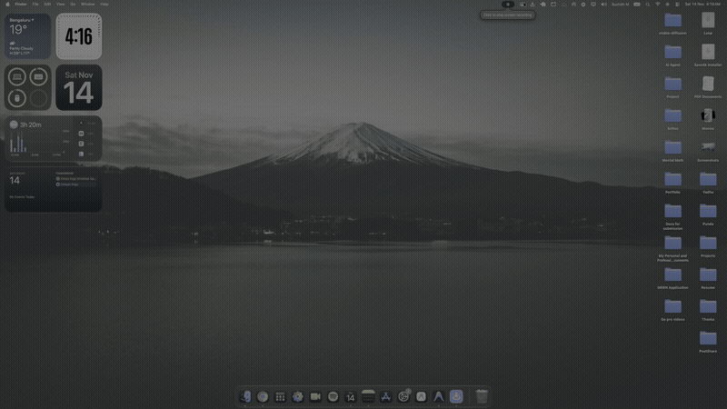

# Loop – Video Desktop Wallpaper for macOS

A lightweight, high-performance native macOS menu bar app that plays any video as a seamless looping desktop wallpaper behind your desktop icons, on every display and every Space, with zero CPU lag and intelligent battery/sleep awareness.

<div align="center">
  
  <p><em>Seamless video wallpaper playing in real-time behind desktop icons on macOS (<a href="assets/demo.mp4">Watch Full Demo Video</a>)</em></p>
</div>

---

## 🚀 Quick Download & Install (For Users)

You do **not** need Xcode or the command line to use Loop.

1. Go to **[Releases](https://github.com/suchithm1999/loop/releases)** and download the latest **`Loop-v1.0.0.dmg`**.
2. Open the downloaded `.dmg` file.
3. Drag **`Loop.app`** into your **`Applications`** folder.
4. Launch **Loop** from your Applications folder or Spotlight.

### 🛡️ First-Launch Gatekeeper Notice
Because Loop is an open-source, community-built app without an Apple Developer ID signature ($99/year), macOS Gatekeeper may show a notice: *"Loop cannot be opened because Apple cannot check it for malicious software"*.

To open it the first time:
- **Option 1 (Easiest)**: In Finder, **Right-Click** (or Control-Click) `Loop.app` → select **Open** → click **Open** in the dialog.
- **Option 2**: Go to **System Settings → Privacy & Security**, scroll down to the *Security* section, and click **Open Anyway**.
- **Option 3 (Terminal)**: Run `xattr -cr /Applications/Loop.app` to clear the quarantine flag.

---

## 🛠️ Build From Source (For Developers)

### Requirements
- macOS 14 (Sonoma), macOS 15 (Sequoia), or later
- Apple Silicon (M1/M2/M3/M4) or Intel Mac
- Xcode Command Line Tools (`xcode-select --install`)

### One-Command Build & Run
```bash
git clone https://github.com/suchithm1999/loop.git
cd loop
./build.sh
```

### Packaging a Release (.dmg & .zip)
To produce a distribution DMG and ZIP package for GitHub Releases:
```bash
./package.sh
```
The output files will be in `dist/`:
- `dist/Loop-v1.0.0.dmg` (Drag-and-drop installer)
- `dist/Loop-v1.0.0.zip` (Portable archive)

### Opening in Xcode
```bash
open Package.swift
```

---

## ✨ Features

- 🖥 **Universal Multi-Display**: Plays seamlessly across all connected monitors, resolutions, and macOS Spaces.
- 🔄 **Gapless Looping**: Uses hardware-accelerated `AVFoundation` (`AVPlayerLooper`) with zero gap or stutter at the loop point.
- ⚡ **Ultra-Efficient**: Decoder sharing and hardware acceleration keep CPU consumption strictly under 3% for 1080p and 4K HEVC video.
- 🔋 **Battery Smart (Configurable)**: Keep playing while on battery, and automatically pause only when your battery drops below a chosen percentage (e.g. 20%), or choose to pause whenever unplugged. Instant detection via IOKit event-driven power notifications.
- 👁 **Occlusion Aware**: Automatically pauses when your desktop is fully covered by full-screen apps or maximized windows.
- 😴 **Sleep & Display Sleep Aware**: Automatically pauses when screens sleep, resumes instantly on wake.
- 🔒 **Lock Screen & Screen Saver Included**:
  - Automatically applies a crisp matching poster frame from your video as macOS's native system desktop image for the Lock Screen.
  - Automatically bundles and installs **`LoopSaver.saver`** to play the full live video when your Mac is idle or the screen saver starts.
- 💾 **Persistent Settings**: Remembers last video, audio mute, scaling modes, battery preferences, and display toggles across reboots.
- 🪟 **Native SwiftUI Settings**: Compact, scrollable settings window with live muted video preview.

---

## 📖 Usage

1. Look for the **⏵🖥** icon in your macOS menu bar.
2. Click **"Choose Video…"** and select any `.mp4`, `.mov`, or `.m4v` file.
3. The video immediately starts looping silently behind your desktop icons.

### Menu Options
| Option | Description |
|---|---|
| **Choose Video…** | Pick a new video file |
| **Play / Pause** | Toggle video playback |
| **Mute** | Toggle video audio (muted by default) |
| **Settings…** | Open the settings window |
| **Launch at Login** | Automatically start Loop when you log into your Mac |
| **Quit Loop** | Exit Loop and remove wallpaper windows |

### Settings Window Controls
- **Scaling Mode**: Choose between **Fill** (aspect fill), **Fit** (aspect fit), or **Stretch**.
- **Per-Display Toggles**: Enable or disable wallpaper playback individually per connected monitor.
- **Lock Screen & Screen Saver**:
  - Test screen saver playback with a single click.
  - Re-sync poster frame and screen saver video.
  - Quick shortcuts to macOS Wallpaper, Screen Saver, and Lock Screen settings.

---

## 🚢 Publishing to GitHub (Release Guide)

### 1. Push your repository
```bash
git init
git add .
git commit -m "Initial commit of Loop app"
git branch -M main
git remote add origin https://github.com/suchithm1999/loop.git
git push -u origin main
```

### 2. Automatic Releases via GitHub Actions
A pre-configured GitHub Actions workflow (`.github/workflows/release.yml`) is included. Whenever you push a release tag:
```bash
git tag v1.0.0
git push origin v1.0.0
```
GitHub Actions will automatically spin up a macOS runner, compile the app and screensaver, generate `Loop-v1.0.0.dmg` and `Loop-v1.0.0.zip`, and publish them directly to your repository's Releases page!

---

## 🏛 Architecture

| Component | Responsibility |
|---|---|
| `LoopApp.swift` | App entry point, accessory activation policy |
| `AppDelegate.swift` | Menu bar item, status menu, screensaver auto-installer |
| `WallpaperController.swift` | Central player, window orchestrator, poster frame generator |
| `WallpaperWindow.swift` | Level `desktopWindow + 1` borderless window with `AVPlayerLayer` |
| `PowerMonitor.swift` | IOKit battery power source detector |
| `Settings.swift` | Persistent defaults & `ScreenSaverDefaults` synchronizer |
| `SettingsView.swift` | Native SwiftUI scrollable settings window |
| `LoopSaverView.swift` | Native companion screensaver bundle for idle/lock playback |
